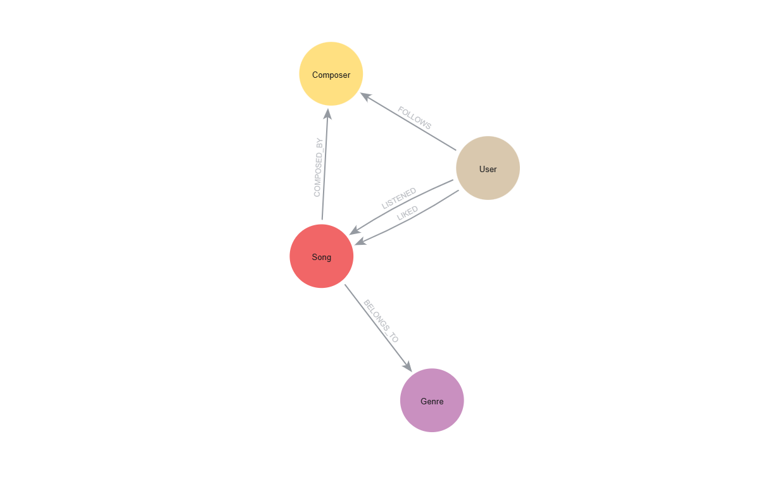
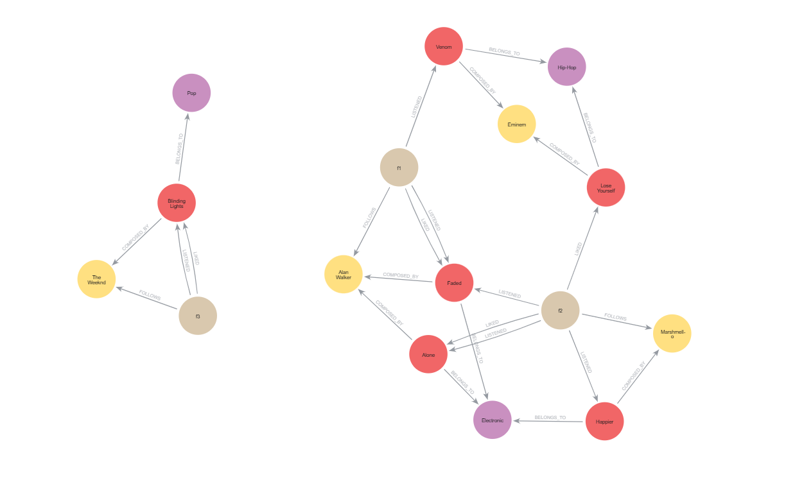
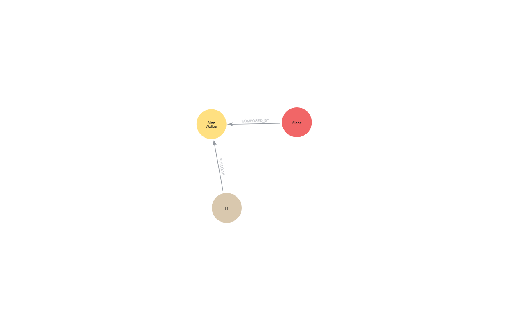

# 🚀 DIO challenge - Creating a Music Recommendation Algorithm with Graphs

## 🔎 Challenge Context
You have been hired to develop a music recommendation system that uses graphs to identify listening patterns and suggest new tracks to users. The system must be able to:
* Represent **users**, **songs**, **composers**, **genres** as graph nodes.
* Represent interactions (like **listening**, **liking**, **following**) as relationships with properties.
* Use **Cypher queries** to generate personalized recommendations based on graph connections.

## ❗ Graph Data Model & Setup

### Nodes & Relationships
* **Nodes:** `:User`, `:Song`, `:Composer`, `:Genre`
* **Relationships:** `[:LISTENED {plays}]`, `[:LIKED]`, `[:FOLLOWS]`, `[:COMPOSED_BY {date}]`, `[:BELONGS_TO]`

### 💻 How to Run
1. Open a free instance on **Neo4j AuraDB** (Query tab).
2. Run [`01-seed.cypher`](./queries/01-seed.cypher) to populate the database using `MERGE` statements.
3. Execute the analytical queries from [`02-recommendations.cypher`](./queries/02-recommendations.cypher).

## 🔨 Business Questions & Cypher Solutions

### 1. Artist-Based Recommendation
**Question:** Which songs were composed by artists that user `f1` follows, but `f1` hasn't listened to yet?
```cypher
MATCH (u:User {name: 'f1'})-[:FOLLOWS]->(c:Composer)<-[:COMPOSED_BY]-(rec:Song)
WHERE NOT (u)-[:LISTENED]->(rec)
RETURN c.name AS Composer, rec.name AS RecommendedSong
```

### 2. Genre-Based Recommendation (Content-Based Filtering)
**Question:** Based on the genres of songs that `f1` liked, what other tracks from the same genre haven't they listened to?
```cypher
MATCH (u:User {name: 'f1'})-[:LIKED]->(s:Song)-[:BELONGS_TO]->(g:Genre)<-[:BELONGS_TO]-(rec:Song)
WHERE NOT (u)-[:LISTENED]->(rec)
RETURN DISTINCT g.name AS Genre, rec.name AS RecommendedSong
```

### 3. Collaborative Filtering
**Question:** Which songs were liked by other users who listened to the same tracks as `f1`?
```cypher
MATCH (u:User {name: 'f1'})-[:LISTENED]->(s:Song)<-[:LISTENED]-(other:User)-[:LIKED]->(rec:Song)
WHERE NOT (u)-[:LISTENED]->(rec)
RETURN DISTINCT other.name AS SimilarUser, rec.name AS RecommendedSong
```

### 4. Platform Popularity Ranking
**Question:** What are the top 3 most played songs across all users?
```cypher
MATCH (:User)-[r:LISTENED]->(s:Song)
RETURN s.name AS Song, SUM(r.plays) AS TotalPlays
ORDER BY TotalPlays DESC
LIMIT 3
```

## Graph Visualization

### 1. Database Schema (`CALL db.schema.visualization()`)


### 2. Populated Music Graph (`MATCH (n)-[r]->(m) RETURN n, r, m`)


### 3. Artist-Based Recommendation Path


## Key Learnings
* **Avoiding Duplicate Nodes with `MERGE`:** Learned why using `MERGE` on full paths creates duplicate nodes when part of the pattern is missing, and how to solve it by merging individual nodes before relationships.
* **Relationship Direction & Uniqueness:** Understood how Cypher prevents traversing the same relationship twice within a single `MATCH` pattern and why arrow direction matters for readability and accuracy.
* **Implicit Aggregation:** Practiced using `SUM()`, `ORDER BY`, and `LIMIT` without needing a SQL-style `GROUP BY` clause.